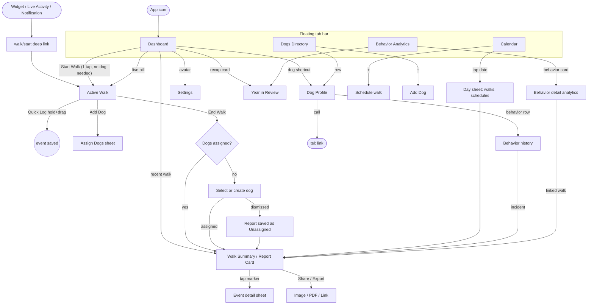

# 2. Screen Map, Navigation, and User Flows

## 2.1 Navigation model

A floating liquid-glass tab bar with four destinations and a raised center action:

```
 ┌──────────────────────────────────────────────┐
 │  Home     Calendar    (● Start)   Dogs  Insights │
 └──────────────────────────────────────────────┘
```

- The center orb is **Start Walk** when idle. While a walk is recording it morphs into a **live pill** (elapsed time, red recording dot) that returns to the Active Walk screen.
- Settings opens from the avatar on the Dashboard. Year in Review opens from Insights and from a seasonal card on the Dashboard.
- Active Walk is a full-screen modal outside the tab stack, so navigating elsewhere never unmounts or interrupts recording (recording does not live in React anyway).
- Secondary screens push onto the current tab's stack. Sheets (assign dogs, event detail, filters) use native form sheets with glass backgrounds.



## 2.2 Screen blueprints

### Dashboard
1. Greeting row: "Good evening, Sam", avatar (Settings), sync status dot (only shown when something needs attention).
2. **Start Walk hero**: large glass orb with a soft inner glow. One tap starts GPS recording. Secondary text button underneath: "Choose dogs first" (optional, opens assign sheet and then starts).
3. Current walk card (if recording) or Most recent walk card: mini route thumbnail with markers, dogs, distance, duration, event chips.
4. Unassigned walks banner (if any): "1 walk needs a dog".
5. Upcoming: next 3 scheduled walks, "See calendar".
6. Dog shortcuts: horizontal row of avatars.
7. Compact stats strip: this week's walks, distance, time.
8. Recent observations: last 5 events across walks with category color and dog.

### Active Walk
Full-screen map with the route polyline and event markers. Glass overlays:

```
┌──────────────────────────────┐
│ [● REC  32:14]   [GPS ▮▮▮]   │  top: status pill (recording / paused / weak GPS)
│                              │
│            map               │
│                              │
│ ┌──────────────────────────┐ │
│ │ 1.84 mi  32:14  17'26"/mi│ │  metrics panel (tabular numerals, large)
│ │ (Biscuit)(Juno)  [+ Dog] │ │
│ └──────────────────────────┘ │
│  [ ❚❚ ]     ( QUICK LOG )   [■ End] │  thumb zone
└──────────────────────────────┘
```

- Quick Log is the largest control (88pt), placed in the dominant-thumb corner (handedness setting flips layout).
- End Walk requires a press-and-hold (600ms ring fill) instead of a confirmation dialog, preventing accidental stops without adding a modal.
- Pause is a single tap; the whole HUD dims and the status pill shows "Paused".
- Map recenters automatically unless the user has panned; a recenter button appears after panning.
- Screen stays awake optionally (setting), otherwise the lock screen shows the Live Activity / notification.

### Quick Log radial menu (signature interaction)

Geometry: the menu opens as an arc fan above the Quick Log button (about 200° on the side away from the screen edge), sized to the screen width so every target is at least 56pt along the arc.

Gesture model (single continuous press-and-drag):

1. **Press and hold** Quick Log for 180ms. Haptic tick. Ring 1 (categories: Nature, Behavior, Training, Additional) springs open.
2. **Drag** toward a category. The sector under the thumb highlights (glass brightens, icon scales). Selection haptic on each sector change.
3. Crossing ring 1's outer radius opens **ring 2** as an outer arc with that category's events (up to 11 items; Behavior has 10 plus Other).
4. **Release on an event**: event saved immediately with timestamp, last GPS fix, walk id, current dogs. Success haptic and a small glass toast: "Pulling logged · Add trigger".
5. **Optional trigger, still in the same gesture**: hold still on an event for 350ms. The event "locks" into the center label and ring 2 is replaced by the trigger ring (Another dog, Person, Bicycle, Vehicle, Wildlife, Loud noise, Unfamiliar environment, Food, Unknown, custom). Release on a trigger saves event + trigger. Release in the center dead zone saves the event without a trigger.
6. **Cancel**: drag back into the center dead zone and release, or drag off-screen. A "Cancelled" toast confirms nothing was saved.
7. Releasing on a category (without reaching ring 2) switches to **tap mode** with that category open.

Why dwell instead of a third concentric ring: a third ring would extend past the screen edges on most phones. Dwell-to-deepen keeps all targets on screen and is reachable with one thumb. This is the closest reliable equivalent of the requested cascade; flagging it per the brief's instruction about changed interactions.

Tap mode (accessibility and preference): a single tap on Quick Log opens the menu pinned open; taps navigate levels; a back chip and close button are shown. Screen readers get a list-based Quick Log sheet with the same taxonomy (radial geometry is not exposed to VoiceOver/TalkBack).

Post-log details (never blocking): the toast's "Add trigger" / "Add outcome" / "Note" chips stay for 6 seconds. Anything can also be edited from the event marker or the walk report later.

Additional category: Voice note (hold to record, release to save; transcribed later if needed), Photo (opens camera, returns to walk; GPS tagged), Custom event (opens the user's custom types).

Customization (Settings > Quick Log): reorder categories and events, hide defaults, add custom events and triggers, choose icons, set handedness, and choose gesture vs tap as default.

### Walk Summary and Report Card
1. Header: dog photo(s) and names (or "Unassigned walk" with an Assign button), date, start to end time.
2. Hero stats: duration, distance, pace, walker steps (measured or labeled estimate).
3. **Interactive route map**: route plus every event marker visible immediately, category legend, clusters for overlapping events that expand to a stacked list.
4. Behavior breakdown: totals by category, then per event type ("Pulling: 4 incidents", "Loose-leash walking: 6 observations").
5. Weather strip: start and end conditions, high/low, wind, UV, any alert. "Weather unavailable" or "Entered manually" when relevant.
6. Timeline: chronological events; tapping one focuses the map on it.
7. Photos, walker notes, classification and business fields (professional mode only).
8. Actions: Share link (expiring, revocable web link; default expiry 30 days, choices 24 h / 7 d / 30 d), Export image, Export PDF (optional event appendix). Exports are kept in the walk's cloud history (backed up) and can be re-shared later; nothing is saved to the device's photos or files unless the user taps Save.

### Calendar
- Month / Week / Day segmented control. Dog filter chip (All dogs or one dog).
- Monthly stats strip above the grid (walks, unique dogs, distance, time, steps, behavior tags), recalculated as the visible month changes.
- Days show dots: filled for completed walks, ring for scheduled walks.
- Tapping a day opens a sheet listing completed walks (with report links) and scheduled walks.
- "+" creates a scheduled walk (date, time, dogs, client, recurrence, reminder).

### Dogs Directory
- Contacts-style list: alphabetical section headers, index scrubber, search field, segmented filter (All / My dogs / Client dogs). Row: photo, name, breed, owner name for client dogs. "+" adds a dog.

### Dog Profile (structure from the supplied Wag screenshot, original Walkwise visuals)

```
┌──────────────────────────────┐
│ (←)                   (✎)    │  glass icon domes floating over the photo
│ [● Bubba] [○ Luke]           │  household switcher: dogs sharing an owner/client
│                              │
│        full-bleed photo      │  ~45% of screen height, tap or (⤢) for full screen
│                         (⤢)  │
╞══════════════════════════════╡  level-1 glass sheet overlapping the photo
│ Bubba                        │  name (large title)
│ 🐕 Labrador Retriever        │  breed with icon
│ ┌───────┐┌───────┐┌───────┐  │  three tinted attribute tiles
│ │  SEX  ││ SIZE  ││  AGE  │  │  sky / aqua / silver tints
│ │ Male ♂││ Large ││ 4 yrs │  │
│ │       ││51-99lb││ Adult │  │
│ └───────┘└───────┘└───────┘  │
│ Owner: Dana R.        (📞)   │  client dogs only: owner name + call dome
├──────────────────────────────┤
│ Walking overview             │  total walks, distance, time, last walk, average
│ Walk Behavior          (›)   │  auto-populated from logged events, BEFORE notes
│ Notes                        │  free-form
└──────────────────────────────┘
```

1. **Household switcher** (adopted from the screenshot's "Bubba / Luke" chips): avatar chips for dogs that share an owner (a client's dogs, or "My dogs"), so a walker can flip between siblings walked together without going back to the directory. Selected chip is a lavender-tinted control pill.
2. **Full-bleed photo** with floating back, edit, and expand controls; the glass content sheet overlaps the bottom of the photo with a 34 pt radius.
3. **Name and breed** as the sheet's header.
4. **Attribute tiles**: Sex (with symbol), Size (bucket plus weight range: Small up to 25 lb, Medium 26 to 50, Large 51 to 99, Giant 100+, shown in the user's units), Age (years computed from birth date, or "about 4 yrs" when estimated, plus life stage: Puppy under 1, Adult 1 to 7, Senior 8+ as a default that varies by size later if wanted).
5. **Owner row** for client dogs: owner name and a call button (opens the dialer).
6. **Walking overview**: total walks, distance, time, most recent walk, average duration.
7. **Walk Behavior** (before notes): auto-populated list of event types with counts and a sparkline. Tap opens behavior history (date, trigger, outcome, walk, location, note); tapping an incident opens that walk's map focused on the event.
8. **Notes**: walking preferences, habits, temperament, practical instructions.

Deliberately not adopted from the screenshot: the neutered/medical flag (the brief excludes medical sections) and the plain white sheet styling.

### Behavior Analytics (Insights)
- Time filter: Week, Month, Year, All time, Custom.
- Dog selector: All, one dog, or compare up to 4.
- Category cards with totals and a rate. Tapping a behavior opens the detail view: total, per mile, per hour, per walk, trend chart (week/month/year buckets), top triggers, outcomes, weather breakdown, dogs ranked by rate (with exposure shown), linked walks.
- Persistent footnote: "Based on what you recorded. Counts depend on how often you log, and are not a behavioral diagnosis."

### Year in Review
- Year picker and dog selector (All dogs default). Swipeable glass story cards with progress indicator, tap to advance, hold to pause.
- Cards: total walks, miles, hours, steps (measured or estimated, labeled), unique dogs, longest walk (with route), busiest month, most-walked dog, nature/behavior/training totals, behavior trends, most frequent route, distance comparison ("That is Las Vegas to Los Angeles 1.6 times, as the crow flies"), year-over-year comparison.
- Share: renders a card to an image only when the user taps Share.

### Settings
Profile and mode (Owner / Professional / Both), Units, Temperature, Theme, Glass intensity, Reduce motion, Reduce transparency, Lightweight mode, Quick Log layout, Custom events and triggers, Notifications, Location permission status and explanation, Location retention, Weather preferences, Widgets help, Data export, Delete location history, Delete account, Privacy policy.

## 2.3 Core flows

**First launch:** Welcome (glass illustration) > Sign in with Apple / Google / email (account required, needs a connection once) > choose mode (Owner, Professional, Both) > optional "Add your first dog" (skippable) > Dashboard. Location permission is requested at the first Start Walk, not at onboarding.

**Start a walk (1 tap):** Dashboard > Start Walk > (first time only: location permission explainer, then OS prompt; Android 13+: notification permission for the tracking notification) > Active Walk recording.

**Start from widget:** Widget tap > `walkwise://walk/start?source=widget` > app opens directly into Active Walk and starts recording. Android requires the app to be in the foreground to start a location foreground service, and iOS requires the app to start location updates, so the widget opens the app; no further taps are needed.

**End a walk:** Hold End > walk finalizes (final distance recomputed from all points, final weather requested) > if no dogs: "Who did you walk?" sheet with dog list, "New dog", and "Later". Choosing Later saves the walk as Unassigned; it appears on the Dashboard banner and in the calendar.

**Recover an interrupted walk:** App launch > recording walk found but background task is not running > banner: "Recording stopped at 4:12 PM (the app was closed). Resume or Finish". Finish ends the walk at the last recorded point. Resume continues the same walk and records a gap.
