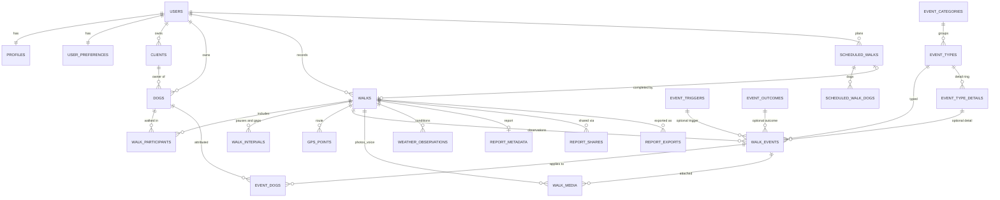

# 3. Database Schema

The full DDL is in [`schema/proposed_schema.sql`](schema/proposed_schema.sql). It has been applied to Postgres 16 + PostGIS 3 locally and smoke tested for: per-user RLS isolation, rejection of spoofed `user_id`, rejection of cross-user dog references, and idempotent replay of GPS point uploads.

## 3.1 Entity map

Mapping to the brief's suggested entities: Users (`auth.users`, `profiles`), Dogs, Clients, Walks, WalkParticipants, GPSPoints, EventCategories, EventTypes, WalkEvents, EventDogs, EventTriggers, EventOutcomes, WeatherObservations, WalkPhotos (`walk_media`, which also stores voice notes), ScheduledWalks (+ `scheduled_walk_dogs`), ReportMetadata (+ `report_shares` for expiring, revocable links and `report_exports` for backed-up image/PDF exports), UserPreferences, SyncOperations. Added: `walk_intervals` (pauses and recording gaps, needed for accurate moving time and honest reports).

## 3.2 Design notes

- **Identifiers**: UUIDv7 generated on device. Upload is `insert ... on conflict (id) do update ... where excluded.client_updated_at > current.client_updated_at`. GPS points use the natural key `(walk_id, seq)` with `on conflict do nothing`.
- **Sync cursor**: every mutable table carries `server_version` from a single sequence, set by trigger. Pull returns rows with `server_version > cursor`. Clock skew between devices cannot hide changes.
- **Soft deletes**: `deleted_at` tombstones replicate deletions; pg_cron hard-purges tombstones after 30 days.
- **Event attribution**: `event_dogs` rows are explicit. When a dog is added mid-walk, only events logged after that moment get the new dog automatically; earlier unattributed events (logged while no dog was assigned) are attributed when the first dog is assigned. The assign sheet shows "Also apply to 3 earlier observations?" when a second dog is added mid-walk (default yes for a shared walk, can be unticked). Nothing is attributed silently after the walk ends.
- **Event details**: `event_type_details` holds nested ring options for a specific event type (seeded: Poop → Consistency: Normal, Soft, Runny). `walk_events.detail_id` is optional, like trigger and outcome.
- **Count wording**: `event_types.count_noun` drives "4 incidents" vs "6 observations" so reports do not imply that loose-leash walking is an "incident".
- **Multi-dog without double counting**: walker totals (distance, time, steps, walk count) aggregate over `walks`. Dog totals aggregate over `walk_participants`. A combined "all dogs" view uses walker totals; a separate "dog-miles" figure is shown only where it is labeled as such.
- **Location retention**: a nightly pg_cron job deletes `gps_points`, clears `walks.route`, `walks.start_point`, and event coordinates for walks older than the user's retention setting, and stamps `location_purged_at`. Totals and observations remain. The same routine backs "Delete location history" in Settings.
- **Units**: SI in storage, conversion only in the presentation layer.

## 3.3 On-device SQLite schema

The local Drizzle schema mirrors the server tables with these differences:

| Local only | Purpose |
|---|---|
| `sync_state` column on each table (`pending`, `synced`) | Fast "unsynced" badges without scanning the outbox |
| `sync_outbox` (`id`, `entity`, `entity_id`, `op`, `created_at`, `attempts`, `next_attempt_at`, `last_error`) | Coalesced queue of pending mutations, one entry per row |
| `sync_cursor` (`scope`, `server_version`) | Pull cursor |
| `active_session` (singleton) | Current walk id, state, last accepted point, running totals, last heartbeat, task registration status |
| `weather_requests` (`walk_id`, `phase`, `lat`, `lng`, `at`, `attempts`) | Deferred weather retrieval |
| `media_uploads` (`media_id`, `local_uri`, `bytes_sent`, `attempts`) | Resumable uploads |
| `transcription_queue` | Deferred speech-to-text |
| `walk_media.local_uri` | Device file path |

Geography columns become plain `lat`/`lng` reals locally; route rendering reads ordered points. SQLite runs in WAL mode so the background task and UI can read and write concurrently.

## 3.4 Analytics definitions (single source of truth in `domain/stats`)

| Metric | Definition |
|---|---|
| Incidents per mile | events of type T for dog D ÷ miles of walks D participated in, within the filter window |
| Incidents per hour | events ÷ moving hours of those walks |
| Per walk | events ÷ walks D participated in |
| Logging coverage | share of D's walks with at least one logged observation. Shown beside every rate. |
| "Logged walks only" toggle | restricts denominators to walks with at least one observation, reducing bias from walks where the user did not log |
| Minimum sample | comparisons (dog vs dog, hot vs cool) require at least 5 walks and 2 hours of exposure per group, otherwise shown as "Not enough data yet" |
| Weather buckets | apparent temperature at the walk's nearest observation: < 5°C, 5 to 15, 15 to 25, > 25 (shown in the user's unit); rain = precipitation > 0.2 mm/h; wind = gusts > 10 m/s |
